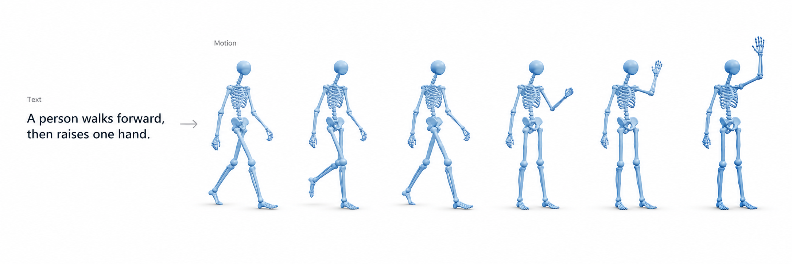

# Awesome Text-to-Motion Generation
**Last updated:** October 29, 2026

A curated collection of research papers, datasets, benchmarks, and resources for **Text-to-Motion (T2M) Generation**, organized by generation methodology and research topic.

This collection focuses on 3D human motion generation from natural language descriptions, including representation learning, autoregressive modeling, masked generative modeling, diffusion, flow matching, and multimodal language models.

Papers are **organized by their primary generation methodology**, while additional techniques and research directions are represented using tags. The main scope is text-conditioned 3D human motion; editing, interaction, and generalist models are included when relevant. ACTOR is retained as an explicitly tagged action-conditioned representation precursor. Pure text-to-video and motion estimation without a text-conditioned generation component are outside the main scope.

**Classification:** Methods are grouped by generation process, with tags for additional techniques and applications.

**Sources and status:** Links point to primary sources; venue and arXiv labels indicate publication status.

**Link priority:** Project Page → Code Repository → arXiv → Official Paper. Keep a paper link alongside the project when adding a new method.

---

 

## Contents

0. [Methodological anchors](#methodological-anchors)
1. [Datasets & Benchmarks](#datasets--benchmarks)
2. [Methods](#methods)
   - [VAE & Representation Learning](#1-vae--representation-learning)
   - [Autoregressive Models](#2-autoregressive-models)
   - [Masked Generative Models](#3-masked-generative-models)
   - [Diffusion & Consistency Models](#4-diffusion--consistency-models)
   - [Flow Matching & Rectified Flow Models](#5-flow-matching--rectified-flow-models)
   - [One-Step Distillation](#6-one-step-distillation)
3. [Specialized Research Topics](#specialized-research-topics)
4. [Evaluation & Alignment](#evaluation--alignment)
5. [Contributing](#contributing)

---

 

# Methodological anchors

A suggested reading route through distinct ideas. These are selections for navigation, not claims that a method was the first or is currently best.

| Method family / question | Selected starting points | Why read them? |
|---|---|---|
| How are language and motion aligned? | [T2M / HumanML3D](https://ericguo5513.github.io/text-to-motion/), [TEMOS](https://mathis.petrovich.fr/temos/) | Establish the text-motion benchmark and continuous latent modeling foundations. |
| Can motion be modeled as tokens? | [T2M-GPT](https://mael-zys.github.io/T2M-GPT/), [MotionGPT](https://motion-gpt.github.io/) | Connect motion quantization to autoregressive generation and motion-language tasks. |
| Can tokens be generated in parallel? | [MMM](https://www.ekkasit.com/MMM-page/), [MoMask](https://ericguo5513.github.io/momask/) | Contrast iterative masked prediction with residual quantization for motion detail. |
| Where should denoising happen? | [MDM](https://guytevet.github.io/mdm-page/), [MLD](https://chenxin.tech/mld/) | Compare motion-space and learned-latent diffusion. |
| How can generation continue online? | [DART](https://zkf1997.github.io/DART/), [MotionStreamer](https://zju3dv.github.io/MotionStreamer/) | Combine sequential generation with diffusion over motion primitives or causal latents. |
| How can inference become cheaper? | [MotionLCM](https://dai-wenxun.github.io/MotionLCM-page/) | Study latent consistency distillation and controlled generation. |
| How can one model generate and edit? | [MotionLab](https://arxiv.org/abs/2502.02358) | Formulate tasks as source motion, condition, and target motion using rectified flow. |
| What changes at larger scale? | [HY-Motion 1.0](https://arxiv.org/abs/2512.23464), [Kimodo](https://research.nvidia.com/labs/sil/projects/kimodo/) | Study scaled flow matching and controllable motion diffusion outside the conference-only reading route. |

---

 

# Datasets & Benchmarks

| Dataset (Venue) | Description | Link |
|---|---|---|
| HumanML3D (CVPR 2022) | Large-scale text-annotated 3D human motion dataset | [Project](https://ericguo5513.github.io/text-to-motion/) |
| KIT Motion-Language (Big Data 2016) | Human motion sequences paired with natural language descriptions | [Dataset](https://motion-annotation.humanoids.kit.edu/) |
| SnapMoGen (NeurIPS 2025) | Expressive text-motion dataset with detailed descriptions and continuous motion sequences | [Project](https://snap-research.github.io/SnapMoGen/) |
| HumanML3D-E (ICLR 2026) | HumanML3D benchmark stratified by event count to evaluate multi-event motion generation | [Project](https://tjswodud.github.io/EventT2M/) |
| ViMoGen-228K (ICLR 2026) | Large-scale motion dataset combining motion capture, video-derived, and synthesized motion data | [Project](https://motrixlab.github.io/2026_iclr_vimogen/) |
| Motion-X (NeurIPS 2023) | Text-annotated expressive whole-body motion, including hands and face | [Paper](https://arxiv.org/abs/2307.00818) |
| Motion-X++ (arXiv 2025) | Multimodal whole-body motion dataset extending Motion-X | [Paper](https://arxiv.org/abs/2501.05098) |
| MotionVerse (ECCV 2024) | Unified collection across motion tasks, modalities, and skeleton formats; accompanies LMM | [Project](https://mingyuan-zhang.github.io/projects/LMM.html) · [Paper](https://arxiv.org/abs/2404.01284) |
| MotionLib (ICML 2025) | Million-level motion collection with hierarchical text descriptions; distinct from the Go to Zero dataset below | [Paper](https://arxiv.org/abs/2410.03311) |
| MotionMillion / MotionMillion-Eval (ICCV 2025) | Million-scale motion data and zero-shot evaluation from Go to Zero | [Project](https://vankouf.github.io/MotionMillion/) · [Paper](https://arxiv.org/abs/2507.07095) |
| MotionFix (SIGGRAPH Asia 2024) | Source motion, edit instruction, and target motion triplets for supervised editing | [Project](https://motionfix.is.tue.mpg.de/) · [Paper](https://arxiv.org/abs/2408.00712) |
| MotionPercept / MotionCritic (ICLR 2025) | Human preference annotations for perceptual motion quality; accompanies the MotionCritic evaluator | [Project](https://motioncritic.github.io/) · [Paper](https://arxiv.org/abs/2407.02272) |
| AMASS (ICCV 2019) | Unified mocap archive underlying many motion datasets; motion-only source data, without native text captions | [Project](https://amass.is.tue.mpg.de/) |
| BABEL (CVPR 2021) | Sequence- and frame-level English action labels over AMASS, including temporally overlapping actions | [Project](https://babel.is.tue.mpg.de/) |
| InterHuman (IJCV 2024) | Text-annotated two-person interaction motions, introduced with InterGen | [Project](https://tr3e.github.io/intergen-page/) · [Code](https://github.com/tr3e/InterGen) |
| HuMMan-MoGen (NeurIPS 2023) | Fine-grained spatio-temporal descriptions for generation and editing, introduced with FineMoGen | [Project](https://mingyuan-zhang.github.io/projects/FineMoGen.html) |

---

 

# Methods

## 1. VAE & Representation Learning

Methods that learn continuous latent representations or shared text-motion embedding spaces for motion generation.

| Model (Venue) | Key Method | Tags | Link |
|---|---|---|---|
| Language2Pose (3DV 2019) | Joint language-pose embedding learned with a sequence-length curriculum | `Representation Learning` `Alignment` | [Project](https://chahuja.com/language2pose/) |
| ACTOR (ICCV 2021) | Transformer VAE for Action-to-Motion | `VAE` `Transformer` `Action-to-Motion` | [Project](https://mathis.petrovich.fr/actor/) |
| ★ **T2M / HumanML3D (CVPR 2022)** | Temporal VAE + Motion Snippet Codes + Text2Length | `VAE` `Sequential Generation` `Motion Representation` | [Project](https://ericguo5513.github.io/text-to-motion/) |
| ★ TEMOS (ECCV 2022) | Text and motion encoders learn compatible latent distributions for a Transformer VAE decoder | `VAE` `Transformer` | [Project](https://mathis.petrovich.fr/temos/) |
| MotionCLIP (ECCV 2022) | Transformer motion autoencoder aligned with CLIP text and rendered-image embeddings | `CLIP` `Alignment` `Autoencoder` | [Project](https://guytevet.github.io/motionclip-page/) |

 

## 2. Autoregressive Models

Methods that generate motion tokens or motion representations sequentially, conditioned on previously generated elements.

| Model (Venue) | Key Method | Tags | Link |
|---|---|---|---|
| TEACH (3DV 2022) | Autoregressive composition across actions, with a history-conditioned Transformer VAE generating each action | `VAE` `Sequential Composition` `History Conditioning` | [Project](https://teach.is.tue.mpg.de/) |
| TM2T (ECCV 2022) | Discrete motion tokens with autoregressive text-motion translation and inverse-alignment training | `Discrete Tokens` `Motion Captioning` | [Project](https://ericguo5513.github.io/TM2T/) |
| ★ T2M-GPT (CVPR 2023) | VQ-VAE + Autoregressive GPT | `VQ-VAE` `GPT` | [Project](https://mael-zys.github.io/T2M-GPT/) |
| ★ MotionGPT (NeurIPS 2023) | Unified language modeling over vector-quantized motion tokens and text | `Motion Tokens` `Language Model` `Multi-Task` | [Project](https://motion-gpt.github.io/) |
| AttT2M (ICCV 2023) | Body-part VQ-VAE with sentence- and word-level text-motion attention in an autoregressive generator | `Attention` `VQ-VAE` `Body Parts` | [Code](https://github.com/ZcyMonkey/AttT2M) · [Paper](https://arxiv.org/abs/2309.00796) |
| ParCo (ECCV 2024) | Part-specific motion tokenizers and generators coupled by a part-coordination module | `Body Parts` `Coordination` `Discrete Tokens` | [Code](https://github.com/qrzou/ParCo) · [Paper](https://arxiv.org/abs/2403.18512) |
| BAMM (ECCV 2024) | Coarse autoregressive length prediction followed by bidirectional autoregressive token refinement | `Masked Modeling` `Hybrid Attention` | [Project](https://www.ekkasit.com/BAMM-page/) |
| ★ MotionStreamer (ICCV 2025) | Streaming Diffusion-Based Autoregression in Causal Latent Space | `Streaming` `Diffusion` `Continuous Latent` | [Project](https://zju3dv.github.io/MotionStreamer/) |
| MoScale (CVPR 2026) | Coarse-to-fine next-scale autoregression with cross-scale and in-scale refinement | `Multi-Scale` `Hierarchical` `Autoregressive` | [Project](https://zhiwei-zzz.github.io/MoScale/) |
| BAD (arXiv 2024) | Permutation-based corruption with randomized causal ordering to combine sequential and bidirectional dependencies | `Permutation` `Bidirectional` `Hybrid` | [Paper](https://arxiv.org/abs/2409.10847) |
| ★ DART / DartControl (ICLR 2025) | Autoregressive motion primitives sampled by history- and text-conditioned latent diffusion; latent-space spatial control | `Streaming` `Latent Diffusion` `Spatial Control` | [Project](https://zkf1997.github.io/DART/) · [Paper](https://arxiv.org/abs/2410.05260) |
| MOGO (AAAI 2026) | Scale-adaptive residual quantization and hierarchical causal prediction of multi-layer motion tokens | `RVQ` `Hierarchical` `Streaming` | [Code](https://github.com/MiRECoFu/Mogo) · [Paper](https://arxiv.org/abs/2506.05952) |
| ARDY (SIGGRAPH / TOG 2026) | Streaming autoregressive diffusion with explicit root features, latent body motion, and a two-stage denoiser supporting long-horizon constraints | `Streaming` `Diffusion` `Hybrid Representation` `Spatial Control` | [Project](https://research.nvidia.com/labs/sil/projects/ardy/) · [Paper](https://arxiv.org/abs/2607.08741) |

 

## 3. Masked Generative Models

Methods that iteratively predict masked motion tokens, often leveraging bidirectional attention and discrete motion representations.

| Model (Venue) | Key Method | Tags | Link |
|---|---|---|---|
| ★ MMM (CVPR 2024) | Discrete motion tokenizer and text-conditioned masked Transformer with parallel iterative token filling | `VQ-VAE` `Masked Transformer` `Editing` | [Project](https://www.ekkasit.com/MMM-page/) |
| ★ MoMask (CVPR 2024) | Residual motion quantization, masked base-token generation, and residual-layer token prediction | `RVQ` `Hierarchical` `Masked Modeling` | [Project](https://ericguo5513.github.io/momask/) |
| ReMoMask (ECCV 2026) | Momentum text-motion retrieval and semantic spatio-temporal attention in an RVQ-based masked generator | `Retrieval` `Masked Modeling` `RVQ` | [Project](https://aigeeksgroup.github.io/ReMoMask/) |
| MoMask++ / SnapMoGen (NeurIPS 2025) | Multi-Scale Motion Tokenization + Generative Masked Transformer | `Multi-Scale` `Masked Modeling` `Expressive Text` | [Project](https://snap-research.github.io/SnapMoGen/) |
| InterMask (ICLR 2025) | Collaborative masked prediction over two interacting people's 2D VQ motion token maps | `Interaction` `VQ-VAE` `Spatio-Temporal` | [Project](https://gohar-malik.github.io/intermask/) · [Paper](https://arxiv.org/abs/2410.10010) |
| DiMo (arXiv 2026) | Discrete diffusion-style masked refinement for motion generation and understanding, with RVQ and GRPO alignment | `Discrete Diffusion` `RVQ` `GRPO` `Multi-Task` | [Project](https://animotionlab.github.io/DiMo/) · [Paper](https://arxiv.org/abs/2602.04188) |

 

## 4. Diffusion & Consistency Models

Methods that generate motion through iterative denoising in raw motion space or learned latent spaces, including diffusion-derived consistency models.

| Model (Venue) | Key Method | Tags | Link |
|---|---|---|---|
| MotionDiffuse (TPAMI 2024; arXiv 2022) | Text-Conditioned Motion Diffusion | `Diffusion` `Controllability` | [Project](https://mingyuan-zhang.github.io/projects/MotionDiffuse.html) |
| ★ MDM (ICLR 2023) | Classifier-free motion-space diffusion predicting clean motion, enabling geometric and foot-contact losses | `Diffusion` `Motion Editing` | [Project](https://guytevet.github.io/mdm-page/) |
| ★ MLD (CVPR 2023) | Denoise compact continuous motion latents learned by a motion VAE | `Latent Diffusion` `VAE` | [Project](https://chenxin.tech/mld/) |
| Fg-T2M (ICCV 2023) | Linguistic-structure encoding and context-aware progressive reasoning for text-conditioned diffusion | `Fine-Grained Control` `Alignment` | [Paper](https://arxiv.org/abs/2309.06284) |
| ReMoDiffuse (ICCV 2023) | Hybrid motion retrieval, semantic-modulated denoising, and condition-mixture guidance | `Retrieval` `Motion Prior` | [Project](https://mingyuan-zhang.github.io/projects/ReMoDiffuse.html) |
| PriorMDM (ICLR 2024) | Pretrained diffusion priors for DoubleTake long-motion synthesis, ComMDM interaction, and DiffusionBlending control | `Motion Prior` `Composition` | [Project](https://priormdm.github.io/priorMDM-page/) |
| FlowMDM (CVPR 2024) | Diffusion-based composition with blended absolute/relative positional encodings and pose-centric cross-attention | `Diffusion` `Long Motion` `Composition` | [Project](https://barquerogerman.github.io/FlowMDM/) |
| ★ MotionLCM (ECCV 2024) | Motion Latent Consistency Model | `Consistency Model` `Fast Generation` `ControlNet` | [Project](https://dai-wenxun.github.io/MotionLCM-page/) |
| StableMoFusion (ACM MM 2024) | Efficient Motion Diffusion + Foot Contact Correction | `Efficiency` `Foot Contact` | [Project](https://h-y1heng.github.io/StableMoFusion-page/) |
| LGTM (SIGGRAPH 2024) | Local-to-Global Motion Diffusion + LLM Decomposition | `LLM` `Body Parts` `Diffusion` | [Code](https://github.com/L-Sun/LGTM) |
| MARDM (CVPR 2025) | Diffusion-Based Motion Generation with Masked Autoregression | `Diffusion` `Masked Autoregression` `Continuous Latent` | [Code](https://github.com/neu-3dvi/MARDM) · [Paper](https://arxiv.org/abs/2411.16575) |
| SALAD (CVPR 2025) | Skeleton-aware VAE and denoiser, with cross-attention reuse for zero-shot text editing | `Skeleton` `Latent Diffusion` `Editing` | [Project](https://seokhyeonhong.github.io/projects/salad/) |
| Event-T2M (ICLR 2026) | Event decomposition and motion-aware retrieval features injected through event-based cross-attention | `Semantic Decomposition` `Event-Level` | [Project](https://tjswodud.github.io/EventT2M/) |
| HESP (CVPR 2026) | Adaptive Gaussian VAE priors with dynamic cross-modal memory and hierarchical cross-modal attention for diffusion | `Semantic Prior` `Hierarchical` `Disentanglement` | [Paper](https://openaccess.thecvf.com/content/CVPR2026/html/Lv_Hierarchical_Enhancement_of_Semantic_Priors_for_Disentangled_Text-Driven_Motion_Generation_CVPR_2026_paper.html) |
| M2D2M (ECCV 2024) | Discrete motion-token diffusion with token-distance-aware transitions and two-phase sampling for multi-action sequences | `Discrete Diffusion` `Composition` `Long Motion` | [Paper](https://arxiv.org/abs/2407.14502) |
| TMED / MotionFix (SIGGRAPH Asia 2024) | Diffusion conditioned on source motion and an edit instruction, trained on editing triplets | `Editing` `Source Motion` | [Project](https://motionfix.is.tue.mpg.de/) · [Paper](https://arxiv.org/abs/2408.00712) |
| LMM / MotionVerse (ECCV 2024) | Body-part-aware ArtAttention in a diffusion Transformer with unified multimodal training | `Generalist` `Body Parts` `Multimodal` | [Project](https://mingyuan-zhang.github.io/projects/LMM.html) · [Paper](https://arxiv.org/abs/2404.01284) |
| PackDiT (arXiv 2025) | Coupled motion and text diffusion Transformers exchange information through mutual prompting blocks | `Joint Generation` `DiT` `Motion-to-Text` | [Paper](https://arxiv.org/abs/2501.16551) |
| MotionPCM (arXiv 2025) | Phased consistency modeling in motion latent space for one- or few-step synthesis | `Consistency Model` `Fast Generation` | [Paper](https://arxiv.org/abs/2501.19083) |
| MoMug (arXiv 2025) | Fine-tune a pretrained LLM for continuous motion diffusion and autoregressive text prediction | `LLM` `Continuous Motion` `Hybrid` | [Paper](https://arxiv.org/abs/2503.06119) |
| MoMADiff (ACM MM 2025) | Masked autoregressive diffusion over continuous frame-level representations with keyframe prompts | `Masked Autoregression` `Keyframes` `Generalization` | [Paper](https://arxiv.org/abs/2505.11013) |
| GENMO (ICCV 2025) | Combine regression and diffusion by treating motion estimation as constrained generation | `Generalist` `Estimation` `Multimodal` | [Paper](https://arxiv.org/abs/2505.01425) |
| ACMDM (arXiv 2025) | Revisit absolute global joint coordinates for diffusion instead of local-relative motion features | `Representation` `Absolute Coordinates` `Editing` | [Paper](https://arxiv.org/abs/2505.19377) |
| ★ Kimodo (Technical report 2026) | Two-stage root/body denoising with flexible kinematic constraints, trained on 700 hours of optical mocap | `Scaling` `Keyframes` `Trajectory Control` | [Project](https://research.nvidia.com/labs/sil/projects/kimodo/) · [Code](https://github.com/nv-tlabs/kimodo) |
| GMD (ICCV 2023) | Feature projection, imputation, and dense guidance convert spatial goals into diffusion constraints | `Trajectory Control` `Keyframes` `Guidance` | [Project](https://korrawe.github.io/gmd-project/) · [Paper](https://arxiv.org/abs/2305.12577) |
| OmniControl (ICLR 2024) | Combine analytic spatial guidance with learned realism guidance to constrain different joints at different times | `Joint Control` `Spatial Guidance` `Realism Guidance` | [Code](https://github.com/neu-3dvi/OmniControl) · [Paper](https://arxiv.org/abs/2310.08580) |
| PhysDiff (ICCV 2023) | Project denoised motions through physics-based motion imitation during diffusion sampling | `Physics` `Simulation` `Motion Projection` | [Project](https://nvlabs.github.io/PhysDiff/) · [Paper](https://arxiv.org/abs/2212.02500) |
| FineMoGen (NeurIPS 2023) | Spatio-Temporal Mixture Attention combines compositional constraints with sparse mixture-of-experts for detailed generation and editing | `Fine-Grained` `Body Parts` `MoE` `Editing` | [Project](https://mingyuan-zhang.github.io/projects/FineMoGen.html) |
| STMC (CVPR Workshop 2024) | At inference, denoise timeline intervals separately and aggregate predictions by body part to compose overlapping actions | `Timeline Control` `Composition` `Training-Free` | [Project](https://mathis.petrovich.fr/stmc/) · [Paper](https://arxiv.org/abs/2401.08559) |
| InterGen (IJCV 2024) | Text-conditioned interaction diffusion with global relative motion representations and interaction regularization | `Two-Person` `Interaction` `Global Coordinates` | [Project](https://tr3e.github.io/intergen-page/) · [Code](https://github.com/tr3e/InterGen) · [Paper](https://arxiv.org/abs/2304.05684) |

 

## 5. Flow Matching & Rectified Flow Models

Methods that learn continuous transport dynamics between noise and motion distributions, often using conditional velocity fields.

| Model (Venue) | Key Method | Tags | Link |
|---|---|---|---|
| FlowMotion (Computers & Graphics 2025) | Target-predictive conditional flow matching for reduced motion jitter | `Flow Matching` `Smoothness` `Efficiency` | [Project](https://mccuba.github.io/fm-page/) |
| DisCoRD (ICCV 2025) | Rectified-flow decoder reconstructs continuous motion from tokens produced by a pretrained discrete generator | `Discrete Tokens` `Rectified Flow` `Continuous Decoding` | [Project](https://whwjdqls.github.io/discord-motion/) |
| MotionHiFlow (CVPR 2026) | Coarse-to-fine temporal flow paths with noise-consistent cross-scale transitions and a topology-aware VAE | `Hierarchical` `Flow Matching` `Motion VAE` | [Code](https://github.com/ai-lh/MotionHiFlow) · [Paper](https://arxiv.org/abs/2604.23264) |
| UMF (CVPR 2026) | Unified latent motion prior from pyramid flow, followed by semi-noise flow for reaction generation | `Multi-Person` `Flow Matching` `Interaction` | [Project](https://githubhgh.github.io/umf/) |
| ViMoGen (ICLR 2026) | Flow-matching DiT with gated text-to-motion and video-prior-conditioned motion-to-motion branches | `Video Prior` `DiT` `Generalization` | [Project](https://motrixlab.github.io/2026_iclr_vimogen/) |
| DualFlow (ICLR 2026) | Rectified flow for interactive/reactive two-person motion, with text/music retrieval and cross-person attention | `Two-Person` `Interaction` `Retrieval` | [Project](https://gprerit96.github.io/dualflow-page/) |
| ★ MotionLab (ICCV 2025) | Rectified flow maps source motion to target motion under a shared Motion-Condition-Motion task formulation | `Editing` `Generalist` `Rectified Flow` | [Project](https://diouo.github.io/motionlab.github.io/) · [Paper](https://arxiv.org/abs/2502.02358) |
| ★ HY-Motion 1.0 (Technical report / arXiv 2025) | Scale DiT flow matching with motion pretraining, curated fine-tuning, and feedback-based reinforcement learning | `Scaling` `DiT` `Post-Training` | [Code](https://github.com/Tencent-Hunyuan/HY-Motion-1.0) · [Paper](https://arxiv.org/abs/2512.23464) |
| MotionSpaceFlow / MSFlow (arXiv 2026) | Direct motion-space flow matching with representation-aware noise scaling and joint text-motion attention | `Representation` `Motion Space` `Zero-Shot Control` | [Project](https://yu1ut.com/MSFlow-HP/) · [Paper](https://arxiv.org/abs/2609.34190) |

---

 

## 6. One-Step Distillation

Methods that directly train a one-pass student from teacher samples. Distillation alone does not establish that a student uses a consistency or flow-matching objective.

| Model (Venue) | Key Method | Tags | Link |
|---|---|---|---|
| MixiMotion (SOICT 2026, author-reported acceptance) | Offline teacher sample sets with asymmetric matching and decoded-space kinematic supervision | `Distillation` `One-Step` `Kinematics` | [Paper](https://arxiv.org/abs/2609.23010) |

---

 

# Specialized Research Topics

Research directions that extend beyond a single generation methodology. Papers in this section may also appear under Methods.

 

## 1. LLM & Motion-Language Modeling

| Model (Venue) | Research Focus | Link |
|---|---|---|
| MotionGPT (NeurIPS 2023) | Unified Motion-Language Modeling | [Project](https://motion-gpt.github.io/) |
| MotionChain (ECCV 2024) | Conversational Motion Generation via Multimodal Prompts | [Paper](https://arxiv.org/abs/2404.01700) |
| M³GPT (NeurIPS 2024) | Multimodal Multi-Task Motion Comprehension and Generation | [Code](https://github.com/luomingshuang/M3GPT) · [Paper](https://arxiv.org/abs/2405.16273) |
| LGTM (SIGGRAPH 2024) | LLM-Guided Local-to-Global Motion Generation | [Code](https://github.com/L-Sun/LGTM) |
| MoMug (arXiv 2025) | Pretrained LLM combining continuous motion diffusion with discrete text prediction; categorized under diffusion | [Paper](https://arxiv.org/abs/2503.06119) |
| PackDiT (arXiv 2025) | Joint motion-text diffusion offers an alternative to autoregressive motion-language modeling | [Paper](https://arxiv.org/abs/2501.16551) |

 

## 2. Reasoning & Semantic Decomposition

| Model (Venue) | Research Focus | Link |
|---|---|---|
| Motion-R1 (ICLR 2026) | Decomposed Chain-of-Thought + Reinforcement Learning | [Project](https://motion-r1.github.io/) |
| Event-T2M (ICLR 2026) | Event-Level Semantic Decomposition and Temporal Alignment | [Project](https://tjswodud.github.io/EventT2M/) |
| LGTM (SIGGRAPH 2024) | LLM-Based Body-Part Semantic Decomposition | [Code](https://github.com/L-Sun/LGTM) |

 

## 3. Motion Editing & Controllability

| Model (Venue) | Research Focus | Link |
|---|---|---|
| MotionCLIP (ECCV 2022) | Semantic Motion Editing in CLIP Space | [Project](https://guytevet.github.io/motionclip-page/) |
| MDM (ICLR 2023) | Motion In-betweening and Editing | [Project](https://guytevet.github.io/mdm-page/) |
| MotionDiffuse (TPAMI 2024) | Fine-Grained Body-Part Control | [Project](https://mingyuan-zhang.github.io/projects/MotionDiffuse.html) |
| Fg-T2M (ICCV 2023) | Fine-Grained Text-Motion Alignment | [Paper](https://arxiv.org/abs/2309.06284) |
| MMM (CVPR 2024) | Masked Token-Based Motion Editing | [Project](https://www.ekkasit.com/MMM-page/) |
| BAMM (ECCV 2024) | Autoregressive Motion Generation and Editing | [Project](https://www.ekkasit.com/BAMM-page/) |
| MotionLCM (ECCV 2024) | Real-Time Spatial and Temporal Motion Control | [Project](https://dai-wenxun.github.io/MotionLCM-page/) |
| MotionChain (ECCV 2024) | Conversational Instruction-Based Motion Control | [Paper](https://arxiv.org/abs/2404.01700) |
| SALAD (CVPR 2025) | Attention-Based Zero-Shot Motion Editing | [Project](https://seokhyeonhong.github.io/projects/salad/) |
| TMED / MotionFix (SIGGRAPH Asia 2024) | Supervised motion editing from source/edit/target triplets | [Paper](https://arxiv.org/abs/2408.00712) |
| MotionLab (ICCV 2025) | Unified conditional generation and editing via rectified flow | [Project](https://diouo.github.io/motionlab.github.io/) · [Paper](https://arxiv.org/abs/2502.02358) |
| ACMDM (arXiv 2025) | Absolute coordinate representation supports spatial and temporal editing | [Paper](https://arxiv.org/abs/2505.19377) |
| Kimodo (Technical report 2026) | Text plus pose, end-effector, waypoint, and path constraints | [Project](https://research.nvidia.com/labs/sil/projects/kimodo/) |
| GMD (ICCV 2023) | Trajectory, keyframe, and obstacle constraints through diffusion guidance | [Project](https://korrawe.github.io/gmd-project/) |
| OmniControl (ICLR 2024) | Joint-level spatial constraints at arbitrary times with realism guidance | [Code](https://github.com/neu-3dvi/OmniControl) |
| FineMoGen (NeurIPS 2023) | Fine-grained spatio-temporal motion generation and editing | [Project](https://mingyuan-zhang.github.io/projects/FineMoGen.html) |
| ARDY (SIGGRAPH / TOG 2026) | Online text prompts with root paths, full-body keyframes, and sparse joint constraints | [Project](https://research.nvidia.com/labs/sil/projects/ardy/) |

 

## 4. Long-Sequence & Compositional Motion

| Model (Venue) | Research Focus | Link |
|---|---|---|
| TEACH (3DV 2022) | Temporal Action Composition | [Project](https://teach.is.tue.mpg.de/) |
| PriorMDM (ICLR 2024) | Long Motion Generation via Diffusion Prior Composition | [Project](https://priormdm.github.io/priorMDM-page/) |
| FlowMDM (CVPR 2024) | Long-Sequence Motion Composition | [Project](https://barquerogerman.github.io/FlowMDM/) |
| LGTM (SIGGRAPH 2024) | Local-to-Global Compositional Generation | [Code](https://github.com/L-Sun/LGTM) |
| MotionChain (ECCV 2024) | Continuous Motion Generation from Multi-Turn Conversations | [Paper](https://arxiv.org/abs/2404.01700) |
| MotionStreamer (ICCV 2025) | Streaming and Long-Term Motion Generation | [Project](https://zju3dv.github.io/MotionStreamer/) |
| Event-T2M (ICLR 2026) | Multi-Event Motion Generation | [Project](https://tjswodud.github.io/EventT2M/) |
| MoScale (CVPR 2026) | Coarse-to-Fine Hierarchical Temporal Generation | [Project](https://zhiwei-zzz.github.io/MoScale/) |
| DART / DartControl (ICLR 2025) | History-conditioned motion primitives respond to a stream of text prompts | [Paper](https://arxiv.org/abs/2410.05260) |
| M2D2M (ECCV 2024) | Token-aware discrete diffusion and joint sampling for transitions between actions | [Paper](https://arxiv.org/abs/2407.14502) |
| STMC (CVPR Workshop 2024) | Multi-track timelines specify overlapping prompts, body parts, and action timing | [Project](https://mathis.petrovich.fr/stmc/) |
| ARDY (SIGGRAPH / TOG 2026) | Streaming generation with variable history and constraints beyond the current window | [Project](https://research.nvidia.com/labs/sil/projects/ardy/) |

 

## 5. Retrieval-Augmented Motion Generation

| Model (Venue) | Research Focus | Link |
|---|---|---|
| ReMoDiffuse (ICCV 2023) | Retrieval-Augmented Motion Diffusion | [Project](https://mingyuan-zhang.github.io/projects/ReMoDiffuse.html) |
| ReMoMask (ECCV 2026) | Retrieval-Augmented Masked Motion Generation | [Project](https://aigeeksgroup.github.io/ReMoMask/) |
| Event-T2M (ICLR 2026) | Motion-Aware Retrieval for Event Representation | [Project](https://tjswodud.github.io/EventT2M/) |
| DualFlow (ICLR 2026) | Retrieval-Augmented Two-Person Motion Generation | [Project](https://gprerit96.github.io/dualflow-page/) |

 

## 6. Multi-Person & Human Interaction

| Model (Venue) | Research Focus | Link |
|---|---|---|
| PriorMDM (ICLR 2024) | Two-Person Motion Composition | [Project](https://priormdm.github.io/priorMDM-page/) |
| UMF (CVPR 2026) | Variable-Number Multi-Person Motion Generation | [Project](https://githubhgh.github.io/umf/) |
| DualFlow (ICLR 2026) | Interactive and Reactive Two-Person Motion Generation | [Project](https://gprerit96.github.io/dualflow-page/) |
| InterGen (IJCV 2024) | Text-guided two-person diffusion and the InterHuman dataset | [Project](https://tr3e.github.io/intergen-page/) |
| InterMask (ICLR 2025) | Collaborative masked token modeling for interaction and reaction generation | [Project](https://gohar-malik.github.io/intermask/) |

---

 

# Evaluation & Alignment

Supporting methods for retrieval, semantic alignment, and perceptual assessment. These are listed separately because their main contribution is an evaluator or training signal rather than a new motion sampler.

| Resource (Venue / Source) | What it contributes | Link |
|---|---|---|
| TMR (ICCV 2023) | Contrastive text-motion embedding learned alongside motion reconstruction; supports retrieval and embedding-based assessment | [Project](https://mathis.petrovich.fr/tmr/) · [Paper](https://arxiv.org/abs/2305.00976) |
| MotionCritic / MotionPercept (ICLR 2025) | Learned motion-quality critic and human perceptual preferences, useful for evaluating and improving generated motion | [Project](https://motioncritic.github.io/) · [Paper](https://arxiv.org/abs/2407.02272) |

For comparisons, record the dataset split, motion representation, evaluator and checkpoint, sampling protocol, and conditioning inputs alongside scores. For speed claims, include hardware, motion duration, sampling steps, and what the timing includes. Keep retrieval alignment, distributional quality, physical plausibility, and user control as separate evaluation questions.

---

 

# Contributing

Suggestions and corrections are welcome via issues or pull requests. To add a method, include its name, a primary source link, and a brief description of its contribution under the appropriate method category. Preprints and less widely known work are welcome.
